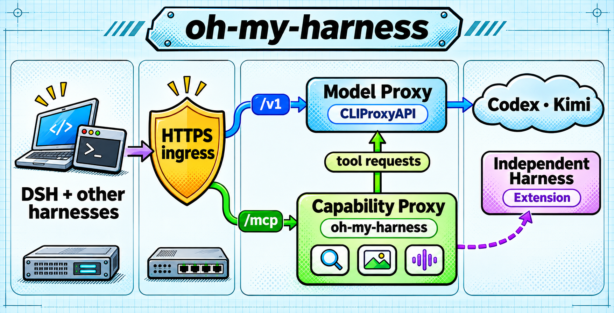

# oh-my-harness

[简体中文](README.zh.md)

A harness that can call a model still needs to integrate each provider's web search, image, document, and speech interfaces. For example, Codex exposes search actions through Responses, while Kimi returns server search results through Messages. Implementing these integrations in every client repeats the routing, request handling, and result parsing.

oh-my-harness packages capabilities from different sources as reusable MCP tools. In DSH, a conversation can use Kimi for reasoning and call Codex's `web_search` for a lookup with sources. The current release uses accounts you authorize in CLIProxyAPI, including paid agent subscriptions. The extension path uses a dedicated adapter in the Capability Proxy to call tools exposed by an independent harness directly. [Architecture](docs/architecture.md)



The solid lines show current routes. The purple dashed line shows the independent harness extension path.

## Start with DSH

Install Node.js 24+ and put the CLIProxyAPI v8.0.51 executable on your PATH as `cli-proxy-api`. [CLIProxyAPI release](https://github.com/router-for-me/CLIProxyAPI/releases/tag/v8.0.51)

```sh
npm ci
npm run init
npm run proxy -- -codex-device-login
npm run proxy -- -kimi-login
```

For a single account, initialize with `npm run init -- --provider codex` or `--provider kimi` and run the matching login command.

Run `npm run proxy` and `npm start` in separate terminals. They start the Model Proxy and Capability Proxy respectively. In a third terminal, check both endpoints and open DSH.

```sh
npm run doctor -- --models
npm run doctor
npm run dsh
```

`npm run dsh` opens a separate DSH Web profile and workspace. Try `mcp__gateway__web_search` in a session, for example by asking for MCP transport options with sources. If a model ID differs from what your account advertises, update `.state/config.json` using the output from `doctor -- --models`. A tool call verifies that the upstream can perform the capability.

| Local endpoint | URL | Key file |
| --- | --- | --- |
| Model Proxy | `http://127.0.0.1:8317/v1` | `.state/model.key` |
| Capability Proxy | `http://127.0.0.1:8318/mcp` | `.state/gateway.key` |

## Use another harness or agent

Point compatible model clients at `/v1` and Streamable HTTP MCP clients at `/mcp`. Use each endpoint's key. A tool client needs only the MCP URL and capability key. DSH's local file adapter converts workspace files into MCP inputs. Other clients can pass Base64 as defined by the tool schemas.

For a hosted deployment on your own server, terminate HTTPS at one Caddy or NGINX ingress and route `/v1` and `/mcp` to the two loopback services. The routes can share a hostname or use separate hostnames. [Architecture and credentials](docs/architecture.md) · [Deployment](docs/deployment.md) · [Providers and tools](docs/providers.md)

`npm test` uses a local simulated upstream to check routing, credential separation, MCP tools, and the file adapter.

[MIT License](LICENSE)
