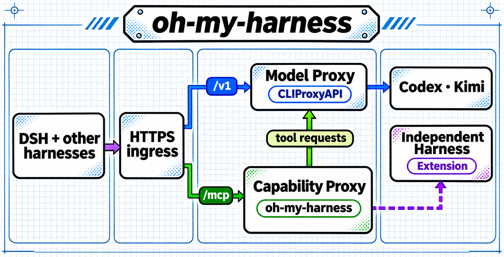

# oh-my-harness

[English](README.md)

一个 harness 能调用模型后，通常还得分别接入各家供应方的搜索、图像、文档和语音接口。以搜索为例，Codex 通过 Responses 返回工具动作，Kimi 通过 Messages 返回服务端搜索结果。每个客户端都接一遍，就要反复处理路由、请求参数和结果格式。

oh-my-harness 把不同来源的能力封装成可复用的 MCP 工具。以 DSH 为例，会话可以用 Kimi 推理，联网查询则调用 Codex 提供的 `web_search` 并取得来源。当前版本通过 CLIProxyAPI 使用已授权的账号，包括已经订阅的付费 Agent 服务。独立 harness 暴露的工具也可以作为能力来源，通过适配器直接接入 Capability Proxy。这条扩展路径需要实现对应的适配器。 [架构说明](docs/architecture.md)



实线表示当前路由。紫色虚线表示独立 harness 的扩展路径。

## 用 DSH 跑通

安装 Node.js 24+，将 CLIProxyAPI v8.0.51 的 `cli-proxy-api` 程序放到 PATH。 [CLIProxyAPI 发布页](https://github.com/router-for-me/CLIProxyAPI/releases/tag/v8.0.51)

```sh
npm ci
npm run init
npm run proxy -- -codex-device-login
npm run proxy -- -kimi-login
```

如果只准备授权一个账号，初始化时用 `npm run init -- --provider codex` 或 `--provider kimi`，只执行对应的登录命令。

在两个终端分别运行 `npm run proxy` 和 `npm start`。第一个启动 Model Proxy，第二个启动 Capability Proxy。再从另一个终端检查入口并打开 DSH。

```sh
npm run doctor -- --models
npm run doctor
npm run dsh
```

`npm run dsh` 启动独立的 DSH Web 配置和工作区。在会话中试用 `mcp__gateway__web_search`，例如请它查询 MCP 的传输方式并列出来源。模型 ID 如果与账号可用的模型不符，根据 `doctor -- --models` 输出调整 `.state/config.json`。工具调用的结果用于验证上游能力。

快速开始通过 MCP 调用工具。如需在 GPT 模型对话中直接获得原生搜索引用和生成图，可在 DSH 主机上安装可选的 Codex 适配器，在 Web profile 中启用，并从它注册的供应方中选择 GPT 模型。 [可选 DSH Codex 扩展](extensions/dsh-native-codex/README.md)

| 本地入口 | 地址 | 密钥文件 |
| --- | --- | --- |
| Model Proxy | `http://127.0.0.1:8317/v1` | `.state/model.key` |
| Capability Proxy | `http://127.0.0.1:8318/mcp` | `.state/gateway.key` |

## 接入其它 harness 或 agent

把兼容的模型客户端指向 `/v1`，把 Streamable HTTP MCP 客户端指向 `/mcp`，分别使用对应密钥。只消费工具的客户端只需要 MCP 地址和能力密钥。DSH 的本地文件适配器把工作区文件转换成 MCP 请求，其它客户端可直接按 MCP 工具 schema 传 Base64。

托管部署时，在自管服务器上用一个 Caddy 或 NGINX 接入层处理 HTTPS，按 `/v1` 和 `/mcp` 分流。两个入口可以共用域名，也可以用独立域名，后端保持回环监听。 [架构与凭据边界](docs/architecture.md) · [部署说明](docs/deployment.md) · [供应方配置和工具](docs/providers.md)

`npm test` 使用本地模拟上游检查路由、密钥隔离、MCP 工具和文件适配器。

[MIT License](LICENSE)
