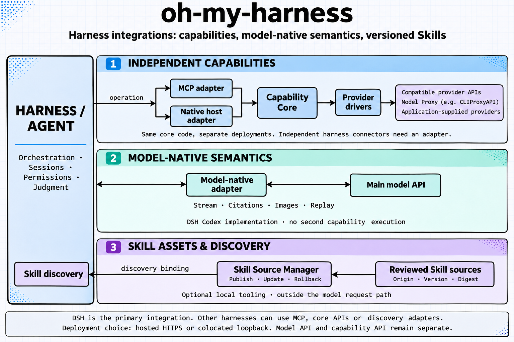

# oh-my-harness

[English](README.md)

**专注 harness 的集成与适配：复用已授权的外部能力和版本化 Skill，编排、会话与权限仍由宿主掌握。**

模型 API、付费 Agent 能力和 Skill 资产面对不同的宿主接口。oh-my-harness 维护这些适配，减少每个 harness 重写执行包装、维护多份源码副本的成本。DSH 是主要集成用例；其它 harness 可使用 MCP、核心 API 或已支持的发现适配。



[架构与职责](docs/architecture.md) · [Hosted HTTPS 部署](docs/deployment.md)

## 选择接入方式

| 需求 | 入口 |
| --- | --- |
| 独立调用搜索、图片、文档、视频或语音操作 | [MCP](#通过-mcp-用-dsh-跑通) 或[原生 DSH 插件](extensions/dsh-capabilities/README.md)，复用同一套核心代码 |
| 在 GPT 主模型对话中保留搜索/生图事件与回放 | [DSH Codex model-native adapter](extensions/dsh-native-codex/README.md) |
| 在多个本地 Agent 间共享已审查的版本化 Skill | [Skill Source Manager](extensions/skill-source-management/README.zh.md)，支持 Codex／Claude Code 发现适配；生命周期写入需要 macOS 和 Python 3.11+ |

三类集成可独立使用。Skill 仍由宿主发现；模型原生能力在主请求内完成，不再作为工具重复执行。账号权限与操作支持需要按已授权路由实际验证。

## 已有 DSH：接入原生能力

针对 **DSH 0.2.2-rc.3**，先运行 `npm ci`，在插件管理器中安装本地仓库根目录，再配置[宿主凭据引用与操作默认值](extensions/dsh-capabilities/README.md)。可以直接使用已有兼容 API，MCP 和 CLIProxyAPI 均为可选项。

Kimi 会话可以用另行配置的 Codex provider 搜索或生图。安装能力插件不会迁移主模型路由。[宿主集成方法](docs/dsh-integration.md) · [验证与 UI 限制](docs/verification/dsh-0.2.2-rc.3.md)

## 通过 MCP 用 DSH 跑通

安装 Node.js 24+，将 [CLIProxyAPI v8.0.51](https://github.com/router-for-me/CLIProxyAPI/releases/tag/v8.0.51) 的 `cli-proxy-api` 程序放到 PATH。此示例复用 CLIProxyAPI 中已授权的账号，包括付费 Agent 订阅，并启动独立的 DSH Web profile。

```sh
npm ci
npm run init
npm run proxy -- -codex-device-login
npm run proxy -- -kimi-login
```

只接入一个账号时，用 `--provider codex` 或 `--provider kimi` 初始化，并只执行对应登录命令。在两个终端分别运行 `npm run proxy` 和 `npm start`，然后执行：

```sh
npm run doctor -- --models
npm run doctor
npm run dsh
```

用 `mcp__gateway__web_search` 查询一个需要来源的问题。根据上游调整 `.state/config.json` 中的模型 ID 和容量，并核验实际结果。模型 API 与 MCP 使用不同密钥；仅使用工具的客户端只需接入 MCP。[其它客户端与已有模型服务](docs/deployment.md)

## 扩展与验证

遵循[扩展流程](docs/providers.md#extension-workflow)：确认宿主所有者，保留来源，只适配缺失边界，分别验证发现、执行和交付。

```sh
npm test
npm run test:skills
npm run verify:package
```

[核心契约](docs/capabilities.md) · [Skill 设计](docs/skill-source-management.zh.md) · [版本验收记录](docs/verification/dsh-0.2.2-rc.3.md)。凭据、实例配置、个人资产与运行状态保存在公开源码之外。[MIT License](LICENSE)
